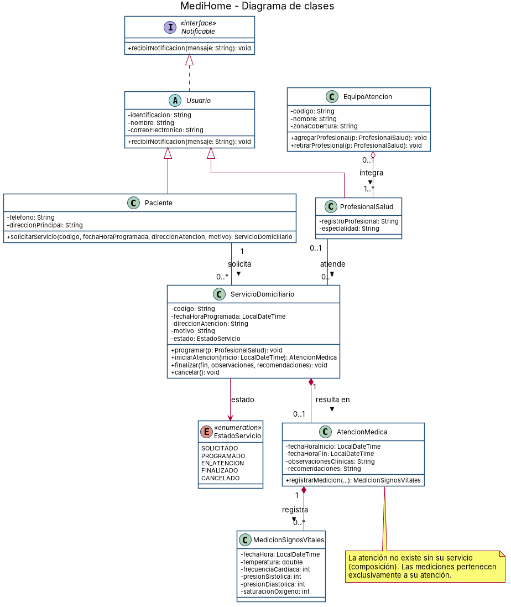

# MediHome

Sistema para administrar los servicios de **MediHome**, empresa que presta atención médica domiciliaria.
Proyecto basado en el enunciado dictado en clase (*Atención médica domiciliaria*).

## Participante

| # | Nombre | Usuario GitHub |
|---|--------|----------------|
| 1 | Samuel Hurtado | [@Hurtado43](https://github.com/Hurtado43) |

## Contenido

```
medihome/
├── diagrama/
│   ├── medihome-diagrama-clases.png   # imagen del diagrama de clases
│   └── medihome-diagrama-clases.puml  # fuente del diagrama (PlantUML)
├── src/medihome/                      # código fuente Java
└── README.md
```

## Diagrama de clases



Decisiones de modelado:

- `Usuario` (abstracta) implementa la interfaz `Notificable`; `Paciente` y `ProfesionalSalud` heredan de ella.
- `Paciente` solicita varios `ServicioDomiciliario`; cada servicio pertenece a un único paciente y recibe un profesional al programarse.
- `AtencionMedica` es **composición** de `ServicioDomiciliario` (no existe sin él) y a su vez compone las `MedicionSignosVitales` (0..*).
- `EquipoAtencion` agrega profesionales; un profesional puede cambiar de equipo sin dejar de existir.
- `EstadoServicio`: SOLICITADO, PROGRAMADO, EN_ATENCION, FINALIZADO, CANCELADO.

## Ejecutar

Requiere JDK 17 o superior.

```bash
mkdir out
javac -encoding UTF-8 -d out src/medihome/*.java
java -cp out medihome.Main
```

`Main` instancia un paciente, un profesional, un servicio domiciliario, una atención y una medición de signos vitales, y al final imprime el reporte de la atención prestada.
